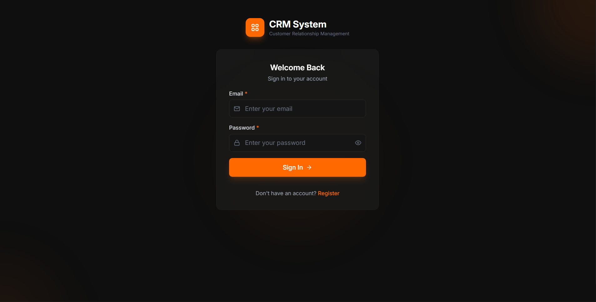
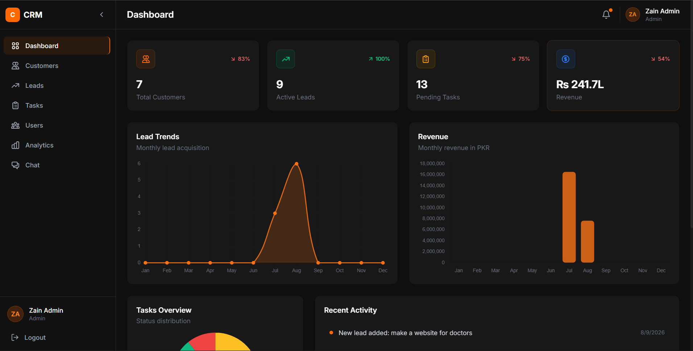
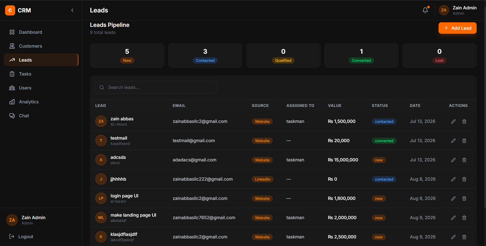
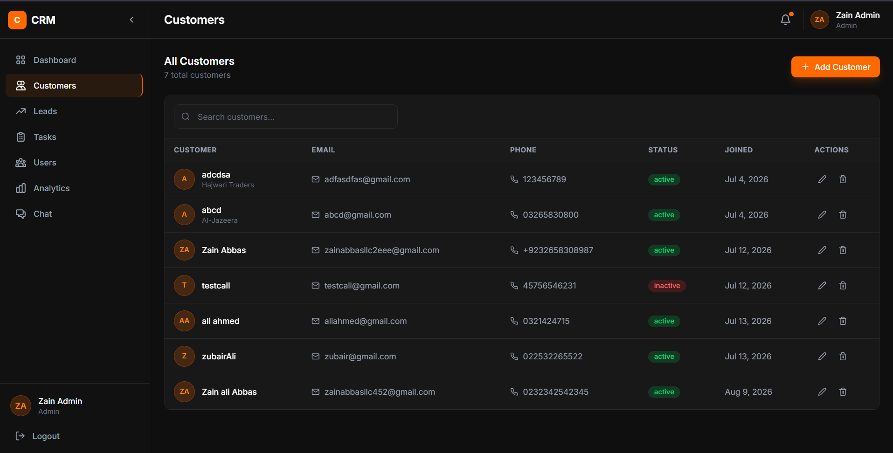

# MERN CRM

A full-stack Customer Relationship Management platform built with MongoDB, Express, React, and Node.js. MERN CRM helps teams manage customers, leads, tasks, opportunities, communication, and business performance from role-based dashboards.

**Live application:** [mern-crm-eta.vercel.app](https://mern-crm-eta.vercel.app)

## Overview

MERN CRM provides separate experiences for administrators, employees, and customers. The application includes protected authentication, customer and lead management, task tracking, analytics, real-time communication, and a growing set of sales and productivity modules.

### User roles

- **Admin**: manage customers, employees, leads, tasks, analytics, and communication.
- **Employee**: work with assigned leads and tasks and review personal performance.
- **Customer**: access profile information, assigned work, and communication with the team.

## Features

- JWT-based authentication and protected routes
- Role-based access control
- Customer profiles, search, notes, tags, and status management
- Lead creation, assignment, source tracking, priorities, and status updates
- Task assignment, priorities, due dates, and progress tracking
- Opportunity and sales pipeline support
- Dashboard metrics and analytics charts
- Real-time chat powered by Socket.IO
- Profile management
- Responsive React interface
- Internationalization foundation with `i18next`
- File upload and export service foundations

Some modules are still under active development. Planned work includes expanded notifications, calendar integration, quotations and invoices, AI insights, broader test coverage, and CI/CD automation.

## Technology stack

### Frontend

- React 19
- Vite
- React Router
- Axios
- Socket.IO Client
- Chart.js and `react-chartjs-2`
- Framer Motion
- Tailwind CSS / Tailwind Vite integration
- `i18next` and `react-i18next`

### Backend

- Node.js
- Express 5
- MongoDB with Mongoose
- JSON Web Tokens
- bcryptjs
- Socket.IO
- Multer
- PDFKit
- dotenv and CORS

## Repository structure

```text
MERN-CRM/
├── README.md
├── CRM Feature list.txt
├── CRM-flowchart.md.txt
├── screenshots/
└── web/
    ├── Backend/
    │   ├── README.md
    │   └── src/
    │       ├── config/
    │       ├── controllers/
    │       ├── middleware/
    │       ├── models/
    │       ├── routes/
    │       ├── seeders/
    │       ├── services/
    │       ├── socket/
    │       ├── utils/
    │       ├── .env.example
    │       ├── package.json
    │       └── server.js
    ├── client/
    │   ├── src/
    │   │   ├── Context/
    │   │   ├── Layouts/
    │   │   ├── Routes/
    │   │   ├── components/
    │   │   ├── guards/
    │   │   ├── hooks/
    │   │   ├── i18n/
    │   │   ├── pages/
    │   │   ├── services/
    │   │   └── socket.js
    │   ├── .env.example
    │   └── package.json
    └── docker-compose.yml
```

## Prerequisites

- Node.js 18 or newer
- npm
- MongoDB running locally or a MongoDB Atlas connection

## Getting started

### 1. Clone the repository

```bash
git clone https://github.com/Zain-Abbas-developer/MERN-CRM.git
cd MERN-CRM
```

### 2. Configure the backend

```bash
cd web/Backend/src
cp .env.example .env
npm install
```

Update `.env` with values for your environment:

```env
PORT=4000
DB_URI=mongodb://localhost:27017/mern-crm
JWT_SECRET=replace_with_a_long_random_secret
CLIENT_URL=http://localhost:5173
NODE_ENV=development
```

Start the API server:

```bash
npm run dev
```

The backend runs at `http://localhost:4000` by default.

### 3. Configure the frontend

Open a second terminal:

```bash
cd web/client
cp .env.example .env
npm install
```

Set the API URL in `.env`:

```env
VITE_API_URL=http://localhost:4000/api
```

Start the Vite development server:

```bash
npm run dev
```

The frontend is then available at the local URL printed by Vite, normally `http://localhost:5173`.

## Available scripts

### Backend (`web/Backend/src`)

| Command | Description |
| --- | --- |
| `npm run dev` | Start the API with Nodemon |
| `npm start` | Start the API in production mode |

### Frontend (`web/client`)

| Command | Description |
| --- | --- |
| `npm run dev` | Start the Vite development server |
| `npm run build` | Create a production build |
| `npm run preview` | Preview the production build locally |
| `npm run lint` | Run ESLint |

## Backend API areas

The API is mounted under `/api` and includes authentication plus protected modules for:

- Authentication and profiles: `/api/auth`
- Customers
- Leads
- Opportunities
- Tasks
- Analytics
- Chat and real-time events

Protected requests use a bearer token:

```http
Authorization: Bearer <jwt-token>
```

See [`web/Backend/README.md`](./web/Backend/README.md) for the backend endpoint and data-model reference.

## Screenshots

| Login | Admin dashboard |
| --- | --- |
|  |  |

| Leads | Customers |
| --- | --- |
|  |  |

| Tasks | Analytics |
| --- | --- |
|  |  |

## Deployment

The frontend is configured for Vercel deployment. For production deployments:

1. Deploy `web/client` as the frontend project.
2. Deploy `web/Backend/src` to a Node.js host such as Render or Railway.
3. Set `VITE_API_URL` to the deployed backend API URL.
4. Configure `DB_URI`, `JWT_SECRET`, `CLIENT_URL`, and `NODE_ENV` on the backend host.
5. Update the backend CORS allowlist for the deployed frontend origin.

Never commit `.env` files or production secrets.

## Roadmap

- Sales pipeline and deals improvements
- Quotations and invoices
- PDF and spreadsheet exports
- Email and in-app notifications
- Calendar integration and activity logs
- Additional file upload workflows
- WhatsApp integration
- AI-assisted CRM insights
- Expanded automated tests
- Docker and CI/CD workflows

## Contributing

1. Fork the repository.
2. Create a feature branch.
3. Make and test your changes.
4. Open a pull request with a clear description.

## License

This project is licensed under the MIT License.

## Author

**Zain Abbas**

- GitHub: [@Zain-Abbas-developer](https://github.com/Zain-Abbas-developer)
