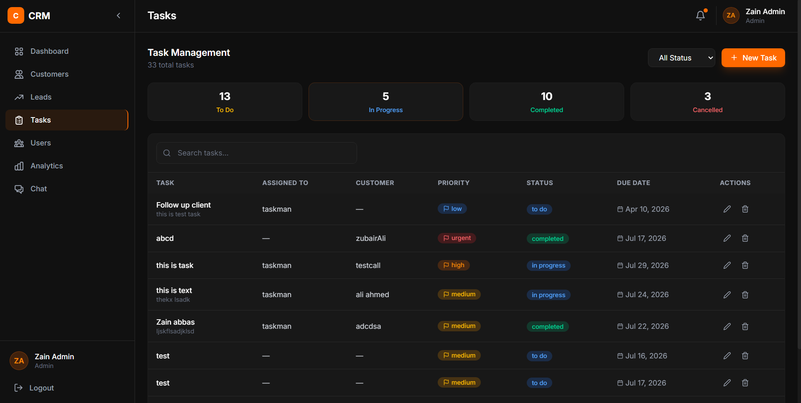
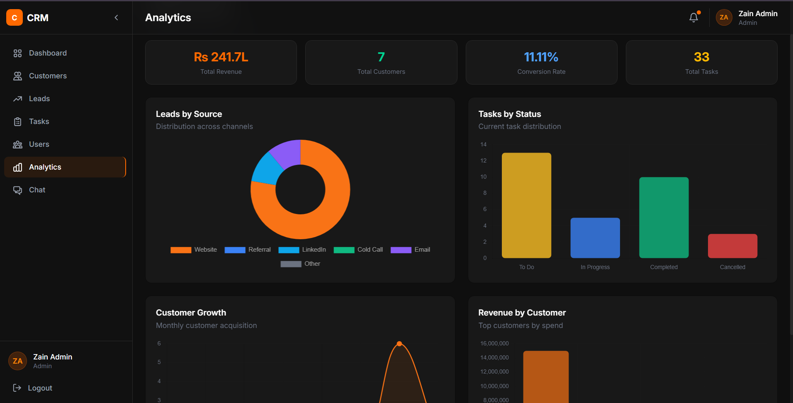

<div align="center">

# MERN CRM

### A modern, role-based CRM for managing customers, leads, tasks, opportunities, and team performance.

[](https://mern-crm-eta.vercel.app)
[](https://react.dev/)
[](https://nodejs.org/)
[](https://www.mongodb.com/)
[](https://socket.io/)

[Features](#features) · [Architecture](#architecture) · [Getting started](#getting-started) · [Deployment](#deployment) · [Roadmap](#roadmap)

</div>

---

## Product overview

MERN CRM is a full-stack customer relationship management platform built for teams that need a central workspace for customer data, sales activity, assignments, communication, and performance visibility.

The system provides tailored dashboards for **administrators**, **employees**, and **customers**, with protected routes and role-aware workflows throughout the application.

> **Project status:** Active development. The core CRM experience is available; several sales, automation, and operational modules are being expanded.

## Features

### Core CRM

- Customer profiles with search, notes, tags, and status management
- Lead creation, assignment, source tracking, priorities, and status updates
- Opportunity and sales pipeline workflows
- Task assignment with priorities, due dates, and progress tracking
- Dashboard metrics and analytics charts
- Profile management and role-aware navigation

### Collaboration and platform

- JWT authentication and protected routes
- Role-based access control for admin, employee, and customer experiences
- Real-time communication with Socket.IO
- Responsive interface for desktop and mobile layouts
- Internationalization foundation with `i18next`
- File upload and PDF export service foundations

### User roles

| Role | Main responsibilities |
| --- | --- |
| **Admin** | Manage employees, customers, leads, tasks, analytics, and communication. |
| **Employee** | Work with assigned leads and tasks and review personal performance. |
| **Customer** | View profile information, assigned work, and team communication. |

## Architecture

```text
┌──────────────────────┐       HTTP / JWT        ┌────────────────────────┐
│   React + Vite UI    │ ──────────────────────▶ │   Express REST API     │
│   Role-aware routes   │                         │   Protected modules    │
└──────────┬───────────┘                         └───────────┬────────────┘
           │                                                 │
           │ Socket.IO                                       │ Mongoose
           ▼                                                 ▼
┌──────────────────────┐                         ┌────────────────────────┐
│ Real-time messaging  │                         │   MongoDB database     │
└──────────────────────┘                         └────────────────────────┘
```

The frontend is located in `web/client`. The backend entry point is `web/Backend/src/server.js`, with controllers, models, routes, middleware, services, and Socket.IO integration organized beneath the same source directory.

## Technology stack

| Layer | Technologies |
| --- | --- |
| Frontend | React 19, Vite, React Router, Axios, Tailwind CSS, Framer Motion |
| Data visualization | Chart.js, `react-chartjs-2` |
| Communication | Socket.IO and `socket.io-client` |
| Backend | Node.js, Express 5, Mongoose |
| Authentication | JSON Web Tokens, bcryptjs, protected route middleware |
| Platform services | Multer, PDFKit, dotenv, CORS |
| Deployment | Vercel-compatible frontend and Node.js backend hosting |

## Repository structure

```text
MERN-CRM/
├── README.md
├── CRM Feature list.txt
├── CRM-flowchart.md.txt
├── screenshots/
└── web/
    ├── Backend/
    │   ├── README.md
    │   └── src/
    │       ├── config/          # Database configuration
    │       ├── controllers/     # Request and business logic
    │       ├── middleware/      # Auth and error handling
    │       ├── models/          # Mongoose schemas
    │       ├── routes/          # API route definitions
    │       ├── seeders/         # Seed data and setup helpers
    │       ├── services/        # Reusable backend services
    │       ├── socket/          # Socket.IO setup and events
    │       ├── utils/           # Shared backend utilities
    │       ├── .env.example
    │       ├── package.json
    │       └── server.js        # HTTP server entry point
    ├── client/
    │   ├── src/
    │   │   ├── Context/         # Shared application state
    │   │   ├── Layouts/         # Dashboard and page layouts
    │   │   ├── Routes/          # Application route configuration
    │   │   ├── components/      # Reusable UI components
    │   │   ├── guards/          # Protected and role-aware routes
    │   │   ├── hooks/           # Reusable React hooks
    │   │   ├── i18n/            # Internationalization setup
    │   │   ├── pages/           # Feature pages and dashboards
    │   │   ├── services/        # API and feature service clients
    │   │   └── socket.js        # Frontend Socket.IO client
    │   ├── .env.example
    │   └── package.json
    └── docker-compose.yml
```

## Getting started

### Prerequisites

- Node.js 18 or newer
- npm
- MongoDB local instance or MongoDB Atlas
- Git

### 1. Clone the repository

```bash
git clone https://github.com/Zain-Abbas-developer/MERN-CRM.git
cd MERN-CRM
```

### 2. Install and configure the backend

```bash
cd web/Backend/src
cp .env.example .env
npm install
```

Set the backend environment variables:

```env
PORT=4000
DB_URI=mongodb://localhost:27017/mern-crm
JWT_SECRET=replace_with_a_long_random_secret
CLIENT_URL=http://localhost:5173
NODE_ENV=development
```

Start the API server:

```bash
npm run dev
```

The API is available at `http://localhost:4000`.

### 3. Install and configure the frontend

Open a second terminal from the repository root:

```bash
cd web/client
cp .env.example .env
npm install
```

Set the frontend API URL:

```env
VITE_API_URL=http://localhost:4000/api
```

Start the Vite development server:

```bash
npm run dev
```

The frontend is normally available at `http://localhost:5173`.

## Environment variables

### Backend: `web/Backend/src/.env`

| Variable | Required | Description | Example |
| --- | --- | --- | --- |
| `PORT` | No | API server port | `4000` |
| `DB_URI` | Yes | MongoDB connection string | `mongodb://localhost:27017/mern-crm` |
| `JWT_SECRET` | Yes | Secret used to sign authentication tokens | Long random value |
| `CLIENT_URL` | Yes | Frontend origin used by the deployment | `http://localhost:5173` |
| `NODE_ENV` | No | Runtime environment | `development` |

### Frontend: `web/client/.env`

| Variable | Required | Description | Example |
| --- | --- | --- | --- |
| `VITE_API_URL` | Yes | Base URL for the backend API | `http://localhost:4000/api` |

Never commit `.env` files, JWT secrets, database credentials, or production tokens.

## Available scripts

### Backend (`web/Backend/src`)

| Command | Purpose |
| --- | --- |
| `npm run dev` | Run the API with Nodemon during development |
| `npm start` | Run the API in production mode |

### Frontend (`web/client`)

| Command | Purpose |
| --- | --- |
| `npm run dev` | Start the Vite development server |
| `npm run build` | Create the production frontend bundle |
| `npm run preview` | Preview the production bundle locally |
| `npm run lint` | Run ESLint against the frontend |

## API surface

The API is mounted under `/api` and currently includes these functional areas:

- `/api/auth` — registration, login, profile access, and profile updates
- Customers — customer CRUD operations, notes, and assignments
- Leads — lead CRUD operations, status changes, notes, and conversion workflows
- Opportunities — opportunity tracking, stages, notes, and customer relationships
- Tasks — task assignment and progress workflows
- Analytics — dashboard and reporting data
- Chat — real-time communication and Socket.IO events

Protected requests require a bearer token:

```http
Authorization: Bearer <jwt-token>
```

For detailed endpoints and data models, see [`web/Backend/README.md`](./web/Backend/README.md).

## Screenshots

<div align="center">

| Login | Admin dashboard |
| --- | --- |
|  |  |

| Leads | Customers |
| --- | --- |
|  |  |

| Tasks | Analytics |
| --- | --- |
|  |  |

</div>

## Deployment

### Frontend

Deploy `web/client` to Vercel or another static hosting provider:

- **Root directory:** `web/client`
- **Build command:** `npm run build`
- **Output directory:** `dist`
- **Environment variable:** `VITE_API_URL=<deployed-api-url>/api`

### Backend

Deploy `web/Backend/src` to a Node.js host such as Render or Railway:

- **Build/install command:** `npm install`
- **Start command:** `npm start`
- Configure `DB_URI`, `JWT_SECRET`, `CLIENT_URL`, and `NODE_ENV`.
- Use a production MongoDB database such as MongoDB Atlas.
- Update the backend CORS allowlist for the deployed frontend origin.
- Enable HTTPS and restrict database network access.

### Production checklist

- [ ] Use a strong, unique `JWT_SECRET`.
- [ ] Use a production MongoDB connection string.
- [ ] Set `NODE_ENV=production`.
- [ ] Configure the exact frontend origin in CORS.
- [ ] Keep secrets in the hosting provider's environment settings.
- [ ] Enable HTTPS for frontend, API, and WebSocket traffic.
- [ ] Review logging, backups, rate limiting, and input validation before public launch.

## Roadmap

- [ ] Complete sales pipeline and deals workflows
- [ ] Add quotations and invoices
- [ ] Expand PDF and spreadsheet exports
- [ ] Add email and in-app notifications
- [ ] Add calendar integration and activity logs
- [ ] Expand file upload workflows
- [ ] Add WhatsApp integration
- [ ] Introduce AI-assisted CRM insights
- [ ] Add comprehensive unit and integration tests
- [ ] Add Docker and CI/CD workflows

## Contributing

Contributions are welcome and appreciated.

1. Fork the repository.
2. Create a focused feature branch: `git checkout -b feat/your-feature`.
3. Install dependencies and run the relevant lint/build checks.
4. Commit your changes with a clear message.
5. Push the branch and open a pull request.

For larger changes, please describe the problem, implementation approach, testing performed, and any environment changes in the pull request.

## Support

If you find a bug or want to suggest an improvement, please [open an issue](https://github.com/Zain-Abbas-developer/MERN-CRM/issues) with reproduction steps, expected behavior, and relevant logs or screenshots.

## License

A license file has not yet been added to this repository. Add an appropriate open-source license before distributing the project for external use.

## Author

**Zain Abbas**  
[GitHub: @Zain-Abbas-developer](https://github.com/Zain-Abbas-developer)
